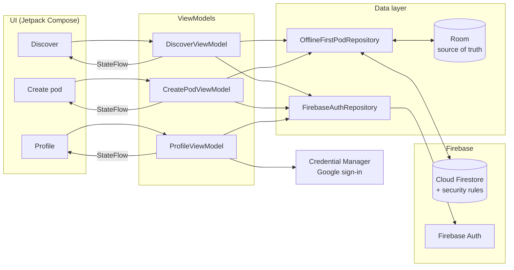

# Reconvene

*Study together, all semester.*

Reconvene is an Android app for Boston University students. You post a study pod (a short, in-person
study session at a building on campus), and other BU students find it and join. It is our final project
for CS 501 (Mobile Application Development) in Fall 2026.

## Status

This is the app as of Update 2 (November 24, 2026). It is not feature-complete yet.

| | Features |
|---|---|
| **Done** | Sign in with a verified @bu.edu Google account. Discover upcoming and ongoing pods, grouped by day, with search, filters and walking times. Create a pod for 2 to 50 people, with suggested buildings and meeting points. Join and leave a pod; the host can cancel it. Groups: the pod's host keeps it as a group for the semester, with invites, handing over the host role, disbanding, group chat, and proposing, voting on and scheduling the next session; members can report a message and block someone. Profile shows this semester's pods, hours and groups, the next pod, an appearance choice (follow the phone, light or dark), blocked people and advice on meeting safely. Pods and groups stay readable offline. App data is left out of backups and device transfer. |
| **Next (Final, Dec 8)** | Reminders before a pod starts. Quick states ("Here", "Running late") with a shared timer. |
| **Deferred** | Deleting an account from the app, a board for asks and offers, matching people by courses and free time, push notifications from the server. |

## Team

| | Role |
|---|---|
| Jimmy He ([@jimmyhe05](https://github.com/jimmyhe05)) | Product and Android UI: UX, Compose screens, navigation, design system |
| Shuxun Zhou ([@ShuxunZhou](https://github.com/ShuxunZhou)) | Backend and data: Firebase Auth and Firestore, security rules, the data layer |

The scrum master rotates weekly. Both of us work across the whole app.

## Architecture

The app follows MVVM with a single source of truth on the device. Screens never talk to Firestore
directly: they show what Room has, and the repository keeps Room in sync with Firestore.



- **Reading pods.** Discover collects a Room `Flow`. A refresh fetches pods that haven't ended from
  Firestore and upserts them into Room, so the list updates on its own and still shows cached pods offline.
- **Creating a pod** saves it to Room first and then hands it to Firestore, which queues the write until
  the network is back.
- **Joining, leaving and canceling** run as Firestore transactions against the server's copy of the pod
  (someone else may have taken the last spot). Room changes only after the server agrees.
- **Who may do what** is enforced twice: in the app, and in [`firebase/firestore.rules`](firebase/firestore.rules),
  which only lets verified @bu.edu users read pods and limits each user to adding or removing themselves.

Dependencies are wired by hand in [`AppContainer`](app/src/main/java/com/reconvene/AppContainer.kt). Without
Firebase settings it swaps in sample pods and turns sign-in off, so the app builds and runs anywhere.

### Code layout

All code is under `app/src/main/java/com/reconvene/`.

| Package | What it holds |
|---|---|
| `data/model` | `Pod`, `Group`, `PodMember` and the rules for joining, canceling, handing over and disbanding |
| `data/local` | Room database, entities, DAOs and type converters |
| `data/remote` | Firestore data source, document mapping, and the sample-data fakes for pods and groups |
| `data/repository` | `OfflineFirstPodRepository` and `OfflineFirstGroupRepository`, which sync Room with the remote |
| `data/auth` | Firebase Auth repository and the @bu.edu account check |
| `ui/discover`, `ui/create`, `ui/profile`, `ui/groups` | One screen per package, each with its ViewModel and UI state |
| `ui/navigation` | Type-safe routes and the bottom navigation tabs |
| `ui/theme`, `ui/components` | Colors, type, shapes and shared composables |

### Tech stack

Kotlin, Jetpack Compose with Material 3, Navigation Compose, ViewModel with `StateFlow`, Kotlin coroutines
and Flow, Room, Cloud Firestore, Firebase Auth, Credential Manager with Sign in with Google, and
kotlinx.serialization. Versions are in [`gradle/libs.versions.toml`](gradle/libs.versions.toml).

## Build and run

You need Android Studio with its bundled JDK (or JDK 21 or newer), and a device or emulator running
Android 8.0 (API 26) or newer.

```bash
git clone https://github.com/jimmyhe05/reconvene.git
cd reconvene
./gradlew assembleDebug
```

Or open the folder in Android Studio and run the `app` configuration. Building from the command line needs
the Android SDK: Android Studio writes its location to `local.properties` when it opens the project, or set
`ANDROID_HOME`.

A fresh clone builds and runs without any Firebase setup. The app then shows sample pods, sign-in is
turned off, and you create and join pods as a local "You". Nothing leaves the device.

To use the real backend with BU sign-in, follow [`firebase/README.md`](firebase/README.md). It walks through
creating the Firebase project, registering your debug certificate, putting four values in `local.properties`,
and publishing the security rules.

## Tests

```bash
./gradlew testDebugUnitTest            # unit tests on the JVM
./gradlew connectedDebugAndroidTest    # instrumented tests on a running emulator or device
```

- **Unit tests** (`app/src/test`) cover the pod and group rules, the @bu.edu check, Firestore document
  mapping, the repositories' sync and error handling, and the Discover, Create and Profile ViewModels.
- **Instrumented tests** (`app/src/androidTest`) cover the Room DAOs against an in-memory database and the
  Create screen with a Compose UI test.
- **CI** ([`.github/workflows`](.github/workflows)) builds the app and runs the unit tests on every pull
  request and every push to `main`.
- **Security rules** were tested against the Firestore emulator before publishing; see
  [`firebase/README.md`](firebase/README.md).

Note that `connectedDebugAndroidTest` uninstalls the app when it finishes, which signs you out on that device.

## Privacy and security

- Only verified @bu.edu Google accounts can sign in, and the Firestore rules check this on the server too.
- A pod stores its host's and members' Google display names and Firebase user ids, nothing else about them.
  Location is read on the phone only when someone taps Nearest first, to show walking times; it is
  never stored or sent.
- The app opts out of Android backup and device-to-device transfer, so cached pods and the signed-in
  session stay on the phone they were made on.
- Firebase settings live in `local.properties`, and `google-services.json` is gitignored. Neither is
  committed. Demos use test pods, not real student data.

## Outside resources and licenses

- Fonts: [IBM Plex Sans and IBM Plex Mono](https://github.com/IBM/plex), under the SIL Open Font
  License 1.1. The license text is in [`licenses/`](licenses).
- Libraries: AndroidX, Jetpack Compose, Room, Kotlin coroutines and kotlinx.serialization (Apache 2.0),
  and the Firebase Android SDKs (Apache 2.0), pulled in through Gradle.
- Icons and the design system follow our own Study Pod prototype.
  <!-- TODO before committing: Jimmy to confirm the icons in res/drawable are our own drawings, not from an icon set. -->

